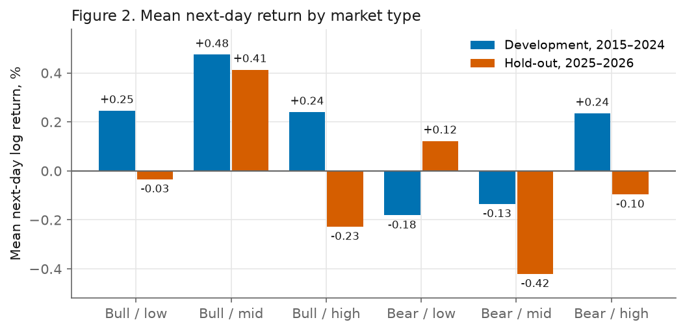

# Is Bitcoin's Direction Predictable?

A pre-registered, out-of-sample test of regime-based forecasting for Bitcoin.

**Paper:** [paper/Bitcoin_Regime_Predictability.md](paper/Bitcoin_Regime_Predictability.md) · [Word version](paper/Bitcoin_Regime_Predictability.docx)

## What this is

An earlier version of this project claimed 60.76% accuracy in predicting Bitcoin's five-day direction. This repository rebuilds that claim, audits it, tests sixteen attempted improvements under walk-forward validation, and then runs twelve frozen hypotheses once on 22 months of unseen data (January 2025 – October 2026).

## Findings

| Result | Development | Hold-out |
| :-- | :-- | :-- |
| Trend regime (50-day average) as a long-or-flat rule | Sharpe 1.54 vs 1.16; drawdown −57% vs −83% | +19.8% vs −17.1%; drawdown −25.5% vs −53.0% |
| Drift in the "rising trend, mid volatility" market type | +0.48% a day, t = 3.48 | +0.41% a day, t = 2.72 |
| Volatility-regime forecast, 5 days | 64.6% accuracy | 62.7% accuracy |
| Original momentum filter (reported 60.76%) | 57.14%, p = 0.059; always-rise 66.9% | 44.0%; always-rise 60.0% |
| Neural networks, direction | 52% | 48% |
| Cross-sectional funding carry | Sharpe 1.25, positive in 108 of 108 variants | Sharpe 0.14 |

Seven of twelve pre-registered hypotheses passed, three failed, one was inconclusive and one was reference-only. The full scorecard is Section 7 of the paper.



## Reproducing the results

```bash
python -m venv .venv && .venv/bin/pip install -r requirements.txt
```

```bash
.venv/bin/python src/baseline.py        # reconstruction of the original claim
.venv/bin/python src/audit.py           # look-ahead, costs, DSR, PBO, robustness
.venv/bin/python src/exp10_map.py       # six market types
.venv/bin/python src/exp10_bayes.py     # sequential Bayesian formula
.venv/bin/python src/exp12_vol_predict.py
.venv/bin/python src/holdout.py         # the single hold-out run
.venv/bin/python src/paper_figures.py
```

Daily data are included in `data/` with SHA-256 checksums. The `fetch_*.py` scripts re-download everything from Yahoo Finance and the public Binance archive. Tested with Python 3.15.

## Layout

| Path | Contents |
| :-- | :-- |
| `paper/` | The paper, figures, and the numbers used in worked examples |
| `src/` | One script per result |
| `results/` | JSON outputs: `baseline`, `audit`, `phase4/` (experiments), `holdout/` |
| `data/` | Price, funding and open-interest series with checksums |
| branches `exp/*` | Each attempted improvement, kept whether or not it worked |

## Method in brief

- Every forecast uses data up to the close of day *t* and targets day *t+1* or later.
- Accuracy is always compared with predicting a rise every time, not with 50%.
- Newey–West standard errors and block bootstrap handle serial dependence.
- Deflated Sharpe Ratio and Probability of Backtest Overfitting account for the number of configurations tried.
- Hold-out code and success criteria were frozen before the 2025–2026 data were read.

## Caveats

One asset, about a decade of data, and a hold-out that covers a falling market. No Sharpe-ratio difference reported here is statistically significant. This is research, not investment advice.
