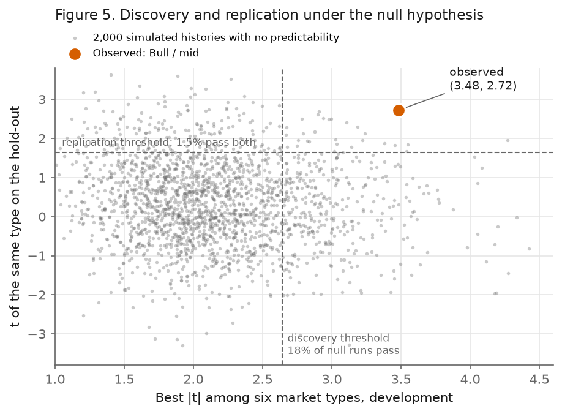
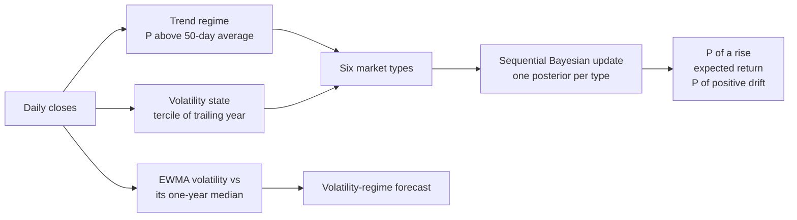

# Is Bitcoin's Direction Predictable?

**A pre-registered, out-of-sample test of regime-based forecasting** · Matvei Shabashov · 2026

[](https://github.com/gougoweg-wq/bitcoin-regime-predictability/actions/workflows/tests.yml)
[](LICENSE)


📄 **[Read the paper](paper/Bitcoin_Regime_Predictability.md)** · [Word version](paper/Bitcoin_Regime_Predictability.docx) · [Hold-out scorecard](#hold-out-scorecard) · [Try it](#quick-start)

---

I once reported that a momentum filter predicted Bitcoin's direction with **60.76%** accuracy. This repository is what happened when I tried to prove it.

The claim did not survive. Rebuilt without look-ahead it was 57.14%, statistically insignificant, and worse than always guessing "up". So I asked a harder question under a stricter protocol: **what in Bitcoin's price history is predictable on data the model has never seen?**



*Each grey dot is one simulated price history with no predictability, pushed through the full research pipeline. One in five "discovers" a significant market type. Almost none also replicate it. The orange point is the real result.*

## Findings

| | Development | Hold-out (2025–2026, unseen) |
| :-- | :-- | :-- |
| **Trend regime** as a long-or-flat rule vs buy-and-hold | Sharpe 1.54 vs 1.16 · drawdown −57% vs −83% | **+19.8% vs −17.1%** · drawdown −25.5% vs −53.0% |
| **One market type** (rising trend, mid volatility) has a real drift | +0.48% a day, *t* = 3.48 | +0.41% a day, ***t* = 2.72** |
| **Volatility regime** is forecastable, 5 days ahead | 64.6% accuracy | **62.7%** (CI 56.3–68.8) |
| Direction via gradient boosting, 32 configurations | AUC 0.497 | — |
| Direction via neural networks | 52% | 48% |
| The original 60.76% momentum filter | 57.14%, *p* = 0.059 | 44% (always-up: 60%) |
| Cross-sectional funding carry | Sharpe 1.25, positive in 108 of 108 variants | Sharpe 0.14 |

**In one sentence:** Bitcoin's *state* (trending or not, calm or turbulent) is persistent and measurable; its next move is close to a coin flip.

## Why this is different from most backtests

| Common failure | What this project does |
| :-- | :-- |
| Parameters tuned on the test data | A 22-month hold-out, opened once, with code frozen and success criteria written first |
| Accuracy compared with 50% | Compared with always predicting a rise, which is the real baseline for a rising asset |
| Features that peek at the future | An automated test rewrites the future and asserts that no past forecast changes |
| The best of many trials reported | Deflated Sharpe Ratio, Probability of Backtest Overfitting, and a permutation test for "best of six" |
| Only successes shown | Sixteen attempted improvements kept on their own branches, failed or not |
| "It's significant" | The whole procedure simulated 2,000 times on unpredictable data to measure its false-positive rate |

That last check produced the most useful number in the project: **a nominal 5% significance threshold gave a false discovery in about 20% of simulated development samples.** Requiring replication on a hold-out cut that to roughly 2%. A result as strong as the reported one appeared twice in 6,000 runs.

## Hold-out scorecard

Twelve hypotheses, frozen before the 2025–2026 data were read.

| # | Hypothesis | Result on unseen data | |
| :-- | :-- | :-- | :-- |
| 1 | Regime rule beats buy-and-hold | Sharpe 0.51 vs −0.02; drawdown −25.5% vs −53.0% | ✅ |
| 2 | Next-day return higher in Bull than Bear | +0.07% vs −0.13% | ✅ |
| 3 | "Bull / mid" drift is positive | +0.41% a day, *t* = 2.72 | ✅ |
| 4 | Volatility regime forecast beats 55% | 62.7% | ✅ |
| 5 | Neural network top-quintile accuracy beats 50% | 43.3% | ❌ |
| 6 | Funding-level forecast beats 70% | 78.8% | ✅ |
| 7 | Bitcoin cash-and-carry earns a positive return | +2.9% a year | ✅ |
| 8 | Cross-sectional carry has a positive Sharpe | 0.14, annual return −5% | ⚠️ |
| 9 | Cross-sectional momentum; regime across 30 contracts | reference only | — |
| 10 | Carry is stronger in Bull than Bear regimes | +51% vs −39% a year | ✅ |
| 11 | Sell-offs with falling open interest rebound | no effect | ❌ |
| 12 | Original momentum filter beats always-up | 44% vs 60% | ❌ |

## Quick start

```bash
git clone https://github.com/gougoweg-wq/bitcoin-regime-predictability && cd bitcoin-regime-predictability
```

```bash
make install
```

```bash
make test
```

**What kind of market is it today?** Fetches public Binance data; no API key needed.

```bash
make status
```

```text
As of close 2026-11-23  (BTC 62,721.97)
  Market type            Bear / high
  P(rise on 2026-11-24)   50.4%
  Expected return        +0.04% per day
  P(drift > 0)           0.604
  Volatility outlook     above its one-year median
```

### As a library

```python
from btcregime import market_types, sequential_posterior, high_volatility_forecast
from btcregime.data import fetch_binance_daily

close = fetch_binance_daily()["close"]
types = market_types(close, keep_last=True)      # Bull/Bear x low/mid/high, known at each close
posterior = sequential_posterior(types)           # P(rise), expected return, P(drift > 0)
turbulent = high_volatility_forecast(close)       # volatility-regime forecast

print(posterior.tail(1))
```

## How it works



For a market type with *n* observed days, sample mean *x̄*, and a prior worth *n₀* = 250 pseudo-days at the overall mean *μ₀*:

$$\hat\mu = \frac{n\,\bar x + n_0\,\mu_0}{n+n_0}, \qquad P(\mu>0) = \Phi\!\left(\frac{\hat\mu\sqrt{n+n_0}}{\sigma}\right)$$

Counts are updated one day at a time, so every forecast is out of sample by construction.

## Repository map

| Path | Contents |
| :-- | :-- |
| [`btcregime/`](btcregime) | The library: regimes, Bayesian model, volatility forecast, statistics, CLI |
| [`tests/`](tests) | 15 tests, including the no-look-ahead guarantee and the paper's headline numbers |
| [`paper/`](paper) | The paper (Markdown and Word), figures, résumé summary |
| [`src/`](src) | One research script per result; `holdout.py` is the single hold-out run |
| [`results/`](results) | JSON output of every experiment, including [`holdout/`](results/holdout) |
| [`data/`](data) | Prices, funding rates, open interest, 913 perpetual futures; SHA-256 checksums |
| [`forecasts/`](forecasts) | Forward-test log: one timestamped forecast per day |
| branches `exp/*` | Each attempted improvement, preserved whether or not it worked |

The research scripts in `src/` are a working log and carry comments in Russian. The library, tests and paper are in English.

## Reproducing the paper

```bash
make reproduce
```

```bash
make figures
```

`tests/test_paper_numbers.py` recomputes the headline figures from the committed data on every push, so the paper and the code cannot drift apart silently.

## Forward test

The hold-out ended in October 2026. To keep testing, [`forecasts/`](forecasts) logs one forecast per day and commits it, so git history proves each forecast was made before its outcome. See [forecasts/README.md](forecasts/README.md).

## Limitations

- One primary asset and about a decade of data; the hold-out covers 22 months of a falling market.
- The replicated market-type result rests on 95 days. Its development-stage significance alone does not survive a permutation test (*p* = 0.073); the evidence is the pre-specified hold-out.
- No Sharpe-ratio difference reported here is statistically significant.
- Detecting a 56% hit rate against 50% needs about 390 days of the relevant market type, roughly six years.

This is research, not investment advice.

## Citation

```bibtex
@misc{shabashov2026bitcoin,
  author = {Shabashov, Matvei},
  title  = {Is Bitcoin's Direction Predictable? A Pre-Registered Out-of-Sample Test of Regime-Based Forecasting},
  year   = {2026},
  url    = {https://github.com/gougoweg-wq/bitcoin-regime-predictability}
}
```

## License

[MIT](LICENSE)
