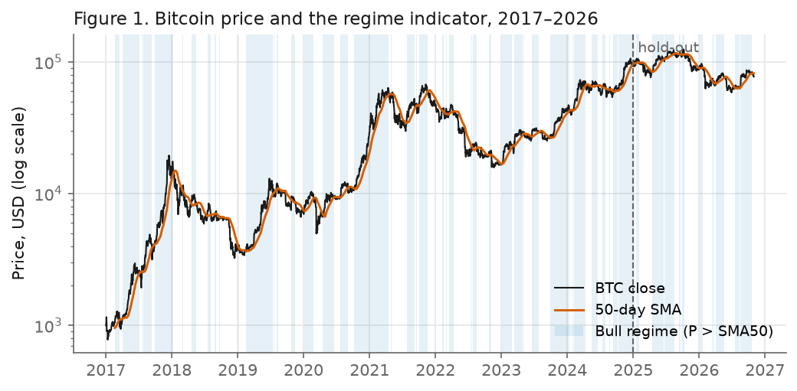
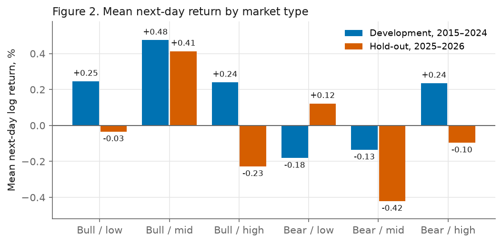
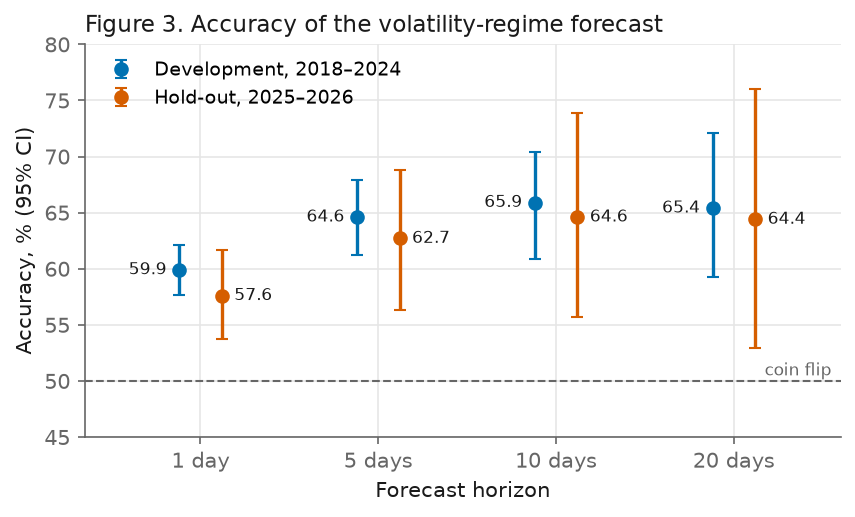
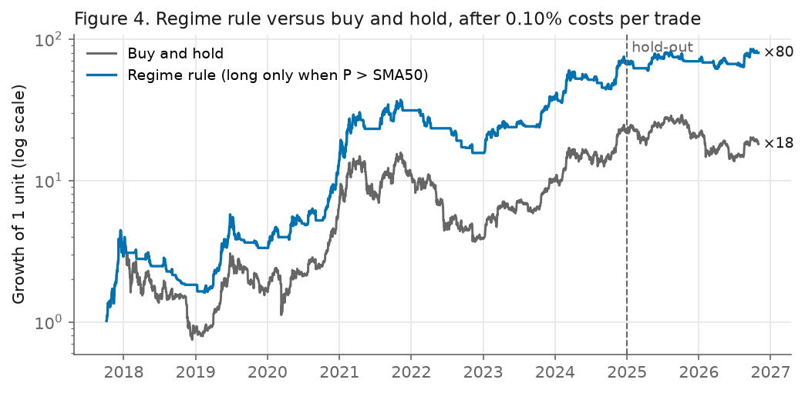

# Is Bitcoin's Direction Predictable? A Pre-Registered Out-of-Sample Test of Regime-Based Forecasting

**Matvei Shabashov** · November 2026 · Code and data: [github.com/gougoweg-wq/bitcoin-regime-predictability](https://github.com/gougoweg-wq/bitcoin-regime-predictability)

---

## Abstract

I test whether a regime-based statistical model can forecast short-term Bitcoin returns, and I do so under a protocol designed to make self-deception difficult: every forecast uses only past information, sixteen candidate improvements are evaluated by walk-forward validation, and twelve hypotheses are then tested once on a 22-month hold-out (January 2025 – October 2026) under success criteria fixed in advance.

Three results survive. (i) A trend regime defined by the 50-day moving average separates next-day mean returns by 0.40% per day (Newey–West $t = 2.77$) and, as a long-or-flat rule, returned +19.8% on the hold-out while the asset lost 17.1%. (ii) A sequential Bayesian model over six market types isolates one type, rising trend with mid-range volatility, whose drift is significant in development ($t = 3.48$, 645 days) and replicates out of sample ($t = 2.72$, 95 days). (iii) Volatility regime is forecastable with 60–66% accuracy by a parameter-free rule, replicated at 58–65%. In simulations of the full discovery-and-replication procedure on return series with no predictability, a result as strong as (ii) arose in 1 of 2,000 runs.

Direction itself is close to unpredictable. Gradient-boosted trees (AUC 0.497), neural networks (48% on hold-out) and a momentum filter that an earlier version of this work reported at 60.76% all fail against the baseline of always predicting a rise. A cross-sectional funding-carry strategy that was positive in all 108 tested configurations during development (Sharpe 1.25) also failed out of sample (Sharpe 0.14), a reminder that parameter robustness does not protect against regime change. The surviving evidence supports a narrow conclusion: Bitcoin's *state* is persistent and measurable; its next move is not.

**Keywords:** Bitcoin, regime models, Bayesian updating, volatility clustering, backtest overfitting, pre-registration, out-of-sample validation.

---

## 1. Introduction

Published and informal claims of 60–70% directional accuracy for cryptocurrency forecasts are common. Most share a weakness: parameters are chosen on the same data used to report accuracy, the comparison is against a coin flip rather than against the asset's own upward drift, and no data are held back.

This project began as one of those claims. An earlier version reported that a momentum filter predicted Bitcoin's five-day direction with 60.76% accuracy. Rather than extend it, I rebuilt it from its own description, audited it, and then asked a broader question under a stricter protocol: *what, if anything, in Bitcoin's price history is predictable out of sample?*

### Contributions

1. **A replication audit of my own result.** The 60.76% figure is shown to be 57.14%, statistically insignificant, inferior to always predicting a rise, and attributable to three identifiable errors (Section 6.1).
2. **A corrected Bayesian formulation.** The original formula inferred a regime that was already observable. I replace it with a sequential posterior for the *next-day return distribution* conditional on an observable market type (Section 3.2).
3. **A calibrated false-positive rate.** A simulation of the full procedure on unpredictable data shows that a nominal 5% threshold yields a false discovery in one development sample in five, and that requiring hold-out replication reduces this to 2.7% (Section 8).
4. **A pre-registered hold-out.** Twelve hypotheses with fixed parameters and stated success criteria are tested once on unseen data. Seven pass, three fail, one is inconclusive and one is reference-only (Section 7).
5. **A documented set of negative results.** Sixteen improvements, including meta-labelling, neural networks and funding-rate features, are reported with their out-of-sample performance whether or not they worked.
6. **Full reproducibility.** One script per result, checksummed data, and a version history in which failed experiments are preserved on their own branches.

---

## 2. Data

| Dataset | Source | Period | Use |
| :-- | :-- | :-- | :-- |
| BTC-USD daily close | Yahoo Finance | Sep 2014 – Oct 2026 | Regime and market-type models |
| BTCUSDT daily and hourly | Binance spot | Aug 2017 – Oct 2026 | Tradable prices, cross-check, intraday features |
| ETHUSDT, SOLUSDT daily | Binance spot | 2017 / 2020 – 2026 | Robustness across assets |
| Funding rates, open interest | Binance USDT-M futures | 2020 – 2026 | Positioning features, carry |
| 913 perpetual futures, daily | Binance USDT-M | 2020 – 2026 | Cross-sectional tests; delisted contracts included |

**Split.** Development: all data to 31 December 2024. Hold-out: 1 January 2025 – 31 October 2026 (669 days), not read by any analysis code until all methods were frozen. Over the hold-out Bitcoin fell 17%, so the test is on an unfavourable market.

**Data quality.** Yahoo and Binance closes differ by a median of 0.11% and by more than 2.8% on 1% of days. Results are reported on both where it matters; strategy returns use Binance prices because they are tradable.

**Survivorship.** The cross-sectional universe is rebuilt each day as the 30 most liquid contracts by trailing 30-day median volume, drawn from all 913 contracts that ever traded, including those since delisted. 175 distinct contracts enter the top 30 at some point.

---

## 3. Methods

### 3.1 Returns and the limits of the Gaussian model

Log returns $r_t = \ln P_t - \ln P_{t-1}$ are used throughout. Under Geometric Brownian Motion, $dP_t = \mu P_t\,dt + \sigma P_t\,dW_t$, Itô's lemma gives $r_t \sim N(\mu - \sigma^2/2,\ \sigma^2)$, and the probability of a rise over $h$ days is

$$P(\text{rise over } h \text{ days}) = \Phi\!\left(\sqrt{h}\,\frac{\mu-\sigma^2/2}{\sigma}\right)$$

With daily drift near 0.2% and volatility near 3.5%, the one-day value is $\Phi(0.05) \approx 52\%$. The model therefore predicts, before any data are examined, that one-day direction is barely better than chance.

The model's assumptions fail in two measurable ways. Daily returns over 2017–2024 have skewness −0.67 and excess kurtosis 11.3; the worst day (12 March 2020, log return −46.5%) lies 12.4 standard deviations from the mean. And $\mu$ and $\sigma$ are not constant, which is the motivation for a regime model.

### 3.2 Regimes and market types

**Trend regime.** Day $t$ is *Bull* if $P_t$ exceeds its 50-day simple moving average and *Bear* otherwise. The label is known at the close of day $t$ and is always paired with the return of day $t+1$.

**Volatility state.** The 30-day realised volatility is ranked within its trailing 365 days: lowest third *low*, middle *mid*, highest *high*.

Two trend states and three volatility states give six observable **market types** $s$.

**Sequential Bayesian model.** Let $\mu_s$ be the mean next-day return in type $s$. With a normal prior centred on the running overall mean $\mu_0$ and worth $n_0$ pseudo-observations, and $n_s$ observed days with sample mean $\bar x_s$ and standard deviation $\sigma_s$, the conjugate update gives

$$\hat\mu_s = \frac{n_s\,\bar x_s + n_0\,\mu_0}{n_s+n_0}, \qquad P(\mu_s>0\mid\text{data}) = \Phi\!\left(\frac{\hat\mu_s\sqrt{n_s+n_0}}{\sigma_s}\right)$$

and, for the frequency of rising days with a Beta prior, $\hat p^{\,\text{up}}_s = (k_s + n_0 p_0)/(n_s+n_0)$, where $k_s$ counts rising days. All counts are updated one day at a time, so each forecast is out of sample by construction. The prior strength $n_0 = 250$ was fixed before testing; it shrinks sparsely observed types toward the overall mean.

*Worked example.* At the end of 2024 the Bull / mid type had $n_s = 645$, $k_s = 363$, $\bar x_s = 0.4752\%$, $\sigma_s = 3.277\%$, with $\mu_0 = 0.1709\%$ and $p_0 = 0.5318$:

$$\hat\mu_s = \frac{645(0.004752)+250(0.001709)}{895} = 0.003902, \qquad z = \frac{0.003902}{0.03277/\sqrt{895}} = 3.56$$

$$P(\mu_s>0) = \Phi(3.56) = 0.9998, \qquad \hat p^{\,\text{up}}_s = \frac{363+250(0.5318)}{895} = 0.554$$

The model is nearly certain that the average move is positive, yet assigns only 55.4% to any single day rising. That gap, between a reliable mean and an unreliable sign, recurs throughout the results.

### 3.3 Volatility-regime forecast

Let $\hat\sigma_t$ be an exponentially weighted volatility estimate with a 10-day half-life. Forecast above-median realised volatility over the next $h$ days if and only if $\hat\sigma_t$ exceeds its own trailing one-year median. No parameter is fitted to the outcome.

### 3.4 Validation protocol

| Risk | Control |
| :-- | :-- |
| Look-ahead | All features use data to the close of day $t$; forecasts target $t+1$ onward. Labels with horizon $h$ are embargoed by $h$ days at every train/test boundary. |
| Serial dependence | Newey–West standard errors for means; circular block bootstrap (2,000 resamples) for accuracies and Sharpe ratios. |
| Wrong benchmark | Every directional accuracy is compared with always predicting a rise on the same observations. |
| Multiple testing | Bonferroni and Holm corrections; Deflated Sharpe Ratio and Probability of Backtest Overfitting (combinatorially symmetric cross-validation) over the full grid of configurations tried. |
| Parameter mining | Primary parameters fixed a priori; neighbouring values reported as sensitivity only. Model selection, where used, is nested inside the training window. |
| Costs | 0.10% per unit of turnover; break-even cost reported. |
| Researcher degrees of freedom | A hold-out with frozen code and written success criteria, run once. |

---

## 4. Results

### 4.1 The trend regime is real, and smaller than it first appears

Pairing a regime label with the same day's return inflates the effect, because a large rise both raises the return and pushes the price above its average. The corrected comparison removes two thirds of it:

| Regime on day $t$ | Mean return, day $t$ | Mean return, day $t+1$ |
| :-- | :-- | :-- |
| Bull | +0.711% | +0.335% |
| Bear | −0.533% | −0.065% |
| Difference | 1.244% | 0.400% |

*Yahoo, 2017–2024; 1,591 Bull and 1,282 Bear days.*

The remaining difference is significant (Newey–West $t = 2.77$, $p = 0.006$). Regimes are persistent, with daily continuation probabilities of 0.957 (Bull) and 0.947 (Bear), implying mean durations of 23 and 19 days.

### 4.2 One market type carries a significant drift, and it replicates

| Market type | Development, 2015–2024 | | | Hold-out, 2025–2026 | | |
| :-- | :-- | :-- | :-- | :-- | :-- | :-- |
| | Days | Mean | $t$ | Days | Mean | $t$ |
| Bull / low | 716 | +0.25% | 2.15 | 203 | −0.03% | −0.28 |
| **Bull / mid** | **645** | **+0.48%** | **3.48** | **95** | **+0.41%** | **2.72** |
| Bull / high | 721 | +0.24% | 1.57 | 44 | −0.23% | −0.91 |
| Bear / low | 607 | −0.18% | −1.59 | 100 | +0.12% | 0.50 |
| Bear / mid | 384 | −0.13% | −0.64 | 101 | −0.42% | −1.89 |
| Bear / high | 477 | +0.24% | 1.22 | 125 | −0.10% | −0.52 |

*Mean next-day log return; Newey–West $t$-statistics.*

With six types the Bonferroni threshold at the 5% level is $|t| > 2.64$. Only Bull / mid passes in development, and it is the only type that is significant on the hold-out. Section 8 shows that this threshold is too lenient for serially dependent data and re-examines the result with a permutation test and simulation. Frequencies of rising days in that type are 56.3% and 55.8%.

The replication is in the mean, not the frequency. On the hold-out, 53 of 95 days rose; an exact binomial test against 50% gives $p = 0.152$. The data support "the average move in this market type is positive" and do not support "the model calls direction correctly 56% of the time".

### 4.3 Volatility regime is forecastable

| Horizon | Development, 2018–2024 | Hold-out, 2025–2026 |
| :-- | :-- | :-- |
| 1 day | 59.9% (57.7 – 62.1) | 57.6% (53.7 – 61.7) |
| 5 days | 64.6% (61.2 – 67.9) | 62.7% (56.3 – 68.8) |
| 10 days | 65.9% (60.9 – 70.4) | 64.6% (55.7 – 73.9) |
| 20 days | 65.4% (59.3 – 72.1) | 64.4% (52.9 – 76.0) |

*Accuracy with block-bootstrap 95% confidence intervals.*

Every interval excludes 50% in both periods. This is volatility clustering, a well-documented property of asset returns, and it explains the contrast with direction: $r_t$ is nearly uncorrelated from day to day while $|r_t|$ is strongly autocorrelated.

### 4.4 Economic value of the regime

A long-or-flat rule, holding Bitcoin only after a Bull label, with 0.10% cost per switch:

| | Regime rule | Buy and hold |
| :-- | :-- | :-- |
| **Development, 2017–2024** | | |
| Sharpe ratio | 1.54 | 1.16 |
| Maximum drawdown | −57% | −83% |
| **Hold-out, 2025–2026** | | |
| Total return | +19.8% | −17.1% |
| Sharpe ratio | 0.51 | −0.02 |
| Maximum drawdown | −25.5% | −53.0% |

Three qualifications apply. The gain is in risk rather than mean return: mean daily returns of the two rules are indistinguishable in development ($t = -0.12$), and the rule is out of the market 45% of the time. The Sharpe difference is not statistically significant, with bootstrap intervals of $(-0.10,\ 0.94)$ in development and $(-0.60,\ 1.54)$ on the hold-out. And the regime rule does not prevent losses in sustained declines: it lost 35% in 2018 and 48% in 2022.

**Tail risk.** The reduction in risk is concentrated where it matters. Daily Value-at-Risk and Expected Shortfall (the mean loss on days beyond the VaR threshold), Binance prices after costs:

| | Development, 2017–2024 | | Hold-out, 2025–2026 | |
| :-- | :-- | :-- | :-- | :-- |
| | Regime rule | Buy and hold | Regime rule | Buy and hold |
| Annualised volatility | 49.8% | 70.5% | 25.7% | 42.9% |
| 99% Value-at-Risk | 7.7% | 10.1% | 3.6% | 5.6% |
| 99% Expected Shortfall | 10.0% | 13.5% | 4.6% | 7.9% |
| Worst day | −14.0% | −39.5% | −7.3% | −14.0% |

A Student-$t$ distribution fitted by maximum likelihood to next-day returns gives $\nu = 2.64$ degrees of freedom in Bull regimes and $\nu = 2.18$ in Bear regimes. Both are below 4, the point at which kurtosis ceases to exist, and the Bear value is close to 2, where variance itself diverges. Tails are heavier in Bear regimes, which is where the rule is out of the market.

**Robustness.** The rule has a positive Sharpe ratio for every moving-average length from 10 to 200 days, with Deflated Sharpe Ratio above 0.999 against zero and a break-even cost of 1.20% per switch, twelve times the assumed fee. It also improves on buy-and-hold for Ethereum (Sharpe 1.06 against 0.83) and Solana (1.76 against 1.41), and across the 30-contract universe (0.83 against 0.53, drawdown −51% against −90%).

---

## 5. What Does Not Add to the Regime

Each method below was evaluated with forecasts made only from past data.

| Method | Specification | Out-of-sample result |
| :-- | :-- | :-- |
| Volatility targeting | Exposure scaled by inverse EWMA volatility | Sharpe 1.32 → 1.36; better in 4 of 8 years |
| Hysteresis band | Entry and exit offset by half a daily $\sigma$ | Turnover halved; Sharpe unchanged |
| Hidden Markov model | Two states, Student-$t$ emissions, annual refit | States separate by volatility, not direction; Sharpe 1.54 → 0.93 |
| Fractional Kelly sizing | Half-Kelly on posterior mean | No improvement |
| Bayesian formula, 5–30 day horizons | Six and twelve market types | Brier score worse than a constant; most confident forecasts correct 18–25% of the time |
| Meta-labelling | Triple-barrier labels, LightGBM and logistic ensemble, 28 features | AUC 0.493 |
| Nested model selection | 32 configurations chosen inside each training window | Mean AUC 0.497; inner and outer AUC *negatively* correlated ($\rho = -0.25$) |
| Neural networks | 2 and 3 hidden layers, daily and 4-hourly, trained from 2014 | 52% in development; 48% on hold-out |
| Positioning | Funding-rate and open-interest conditioning of momentum events | Sign reversed between halves of the sample |

Two of these failures are informative beyond the fact of failing.

The longer-horizon forecasts contradict the $\sqrt{h}$ formula of Section 3.1, which assumes that $\mu$ is constant over the forecast window. Regimes last about 20 days, so a 20- or 30-day forecast spans a regime change more often than not. The conditional frequency of a 20-day rise in a single market type ranged from 0% to 100% across calendar years.

The negative correlation between inner and outer validation scores means that the configurations which looked best on recent data did *worse* subsequently. When model selection is anti-informative, there is no stable structure to select.

A simple formula, tree ensembles and neural networks reach the same ceiling. The limit is in the information content of price and volume history, not in the choice of model.

---

## 6. Two Case Studies in Overfitting

### 6.1 Auditing my own 60.76%

The original signal: when the price is more than 2.4 standard deviations from its 20-day mean, predict that the move continues over five days. Reconstructing the calculation from its written description reproduced every published count exactly except the headline.

| Check | Result |
| :-- | :-- |
| Accuracy at the reported settings | 76 of 133 = 57.14% (60.76% is not a ratio of integers over 133) |
| Exact binomial test against 50% | $p = 0.059$ |
| Always predicting a rise, same events | 66.9% |
| After Holm correction over three reported thresholds | None significant |
| Independent events after removing overlap | About 77, not 133 |
| Deflated Sharpe Ratio over 264 configurations | 0.05 |
| Probability of Backtest Overfitting | 0.68 |
| Fixed settings, 2022–2024 | 51.0% |
| Fixed settings, hold-out | 44.0% on 25 events; always-rise scored 60.0% |

The signal also has no content once the regime is known. Positive extremes occur almost exclusively in Bull regimes and negative ones in Bear regimes; after subtracting each regime's typical return, the residual effect is indistinguishable from zero ($|t| < 1.3$ in every cell, pooled over more than 600 events and three assets).

### 6.2 A strategy that passed every robustness check and still failed

Funding carry across contracts: short the fifth of contracts with the highest seven-day funding rate, long the fifth with the lowest, rebalanced weekly, market-neutral.

| | Development, 2020–2024 | Hold-out, 2025–2026 |
| :-- | :-- | :-- |
| Sharpe ratio (95% CI) | 1.25 (0.23 – 2.24) | 0.14 (−1.39 – 1.75) |
| Annual return | +40% | −5% |
| Maximum drawdown | −41% | −58% |
| Configurations with positive Sharpe | 108 of 108 | not re-run |

In development the result was positive in all 108 neighbouring parameter sets at both 0.10% and 0.30% costs, and in both halves of the sample. It still failed. Funding income rose on the hold-out (38% a year), but price moves against the positions more than offset it. Parameter robustness tests whether a result depends on a particular setting; it does not test whether the market that produced it will persist.

**A regime interaction.** Conditioning the same strategy on Bitcoin's trend regime gives a consistent pattern across the two independent periods:

| Bitcoin regime | Carry, development | Carry, hold-out |
| :-- | :-- | :-- |
| Bull | +59% a year, Sharpe 1.77 | +51% a year, Sharpe 1.43 |
| Bear | +12% a year, Sharpe 0.45 | −39% a year, Sharpe −0.64 |

The difference is not statistically significant in either period ($t = 1.55$ and $1.09$), and I report it as a hypothesis for future data rather than a finding. It is the one place where the regime model suggests value beyond risk reduction.

---

## 7. Hold-Out Scorecard

All twelve hypotheses, with parameters frozen and criteria stated before the hold-out data were read.

| # | Hypothesis | Criterion | Hold-out result | Outcome |
| :-- | :-- | :-- | :-- | :-- |
| 1 | Regime rule beats buy-and-hold | Higher Sharpe and smaller drawdown | 0.51 vs −0.02; −25.5% vs −53.0% | Pass |
| 2 | Next-day return higher in Bull than Bear | Difference > 0 | +0.07% vs −0.13% | Pass |
| 3 | Bull / mid drift is positive | Mean > 0; accuracy > 50% when $\hat p^{\,\text{up}} > 0.55$ | +0.41%, $t = 2.72$; 55.8% | Pass |
| 4 | Volatility regime forecast | 5-day accuracy > 55%, CI above 50% | 62.7% (56.3 – 68.8) | Pass |
| 5 | Three-layer neural network | Top-quintile accuracy > 50%, CI above 50% | 43.3% (37.3 – 50.0) | **Fail** |
| 6 | Funding-level forecast | Accuracy > 70% | 78.8% (74.9 – 83.1); naive 63.4% | Pass |
| 7 | Bitcoin cash-and-carry | Annual return > 0 | +2.9% | Pass |
| 8 | Cross-sectional carry | Sharpe > 0 (weak), > 0.5 (strong) | 0.14; annual return −5% | Inconclusive |
| 9 | Cross-sectional momentum; regime in breadth | Reference only | 0.90; 0.10 vs −0.34 | — |
| 10 | Carry stronger in Bull than Bear | Bull > Bear | +51% vs −39% | Pass |
| 11 | Rebound after sell-offs with falling open interest | Better than with rising open interest | 47.4% vs 43.2% rises; no effect | **Fail** |
| 12 | Original momentum filter | Beats always-rise on the same events | 44.0% vs 60.0% | **Fail** |

A procedural note: the criteria were stated before the run and the frozen code was committed before the data were read, but the criteria file itself was written to disk after the run because of a failed shell command. Its content was not changed. The first invocation of the test script stopped on a missing output directory before printing any result.

---

## 8. Could the Replicated Result Be Chance?

The analyses in this section were run after the hold-out and introduce no new trading hypotheses. They ask how much confidence the market-type result of Section 4.2 deserves.

### 8.1 Permutation test for the best of six

Bull / mid was the largest of six $t$-statistics, so its significance must account for the selection. I shifted the sequence of market-type labels circularly against the return series by a random offset, 5,000 times. This preserves the autocorrelation of both series and destroys only the link between them, giving the null distribution of the *maximum* $|t|$ across six types.

| | Observed $t$ | 95th percentile of null max $|t|$ | Family-wise $p$ | Single-type $p$ |
| :-- | :-- | :-- | :-- | :-- |
| Development | 3.48 | 3.66 | 0.073 | 0.006 |
| Hold-out | 2.72 | 2.49 | 0.018 | 0.002 |

The development result is weaker than the Bonferroni comparison suggested: once serial dependence is respected, the best of six types reaches $p = 0.073$, short of the 5% level. The hold-out is where the evidence is. There the type was named in advance, so the single-type $p = 0.002$ applies, and even the family-wise value is 0.018.

### 8.2 Simulating the whole procedure under no predictability

A permutation test examines one stage. To assess the entire discovery-then-replication sequence, I generated 2,000 artificial price histories by reshuffling Bitcoin's actual daily returns, which keeps their fat-tailed distribution and removes any dependence of tomorrow on today's state. For each history I recomputed moving averages, volatility ranks and market types from scratch, selected the best type on the first 3,549 days, and checked it on the remaining 668.

| Outcome under the null | Shuffled returns | 5-day blocks |
| :-- | :-- | :-- |
| Some type passes $|t| > 2.64$ in development | 19.8% | 22.9% |
| ...and the same type has the same sign with $|t| > 1.645$ on the hold-out | 2.7% | 2.7% |
| ...as strong as observed ($|t| \ge 3.48$, then $\ge 2.72$) | 0.05% | 0.05% |

Two conclusions follow. The nominal 5% Bonferroni threshold produces a false discovery in about one development sample in five, so a development $t$-statistic alone is weak evidence however large it looks. And the hold-out is what restores control: requiring replication cuts the false-positive rate to 2.7%, and a result as strong as the one observed occurred once in 2,000 simulations.

### 8.3 Power: why the frequency test could not succeed

Section 4.2 reported that the frequency of rising days on the hold-out (55.8%) was not significant. A power calculation shows it could hardly have been. To detect a true frequency of 56.3% against 50% with 80% power in a one-sided 5% test requires

$$n = \left(\frac{z_{0.95}\sqrt{0.5 \cdot 0.5} + z_{0.80}\sqrt{0.563 \cdot 0.437}}{0.563-0.5}\right)^{2} = 388 \text{ days}$$

The hold-out contained 95 days of this type, giving a power of 34%. The type occurs about 66 days a year, so a conclusive frequency test needs roughly six years. A test on the mean needs fewer observations, 295 days at the development effect size, which is why the mean replicated first.

For comparison, establishing a 52% directional accuracy, the level a neural network reached in development, would need about 3,900 days. Claims of small directional edges on a few hundred observations cannot be verified at all.

---

## 9. Limitations

- **Sample.** One primary asset and roughly a decade of data. The hold-out is 22 months of a declining market.
- **Power.** The replicated market-type result rests on 95 clustered days. Its development-stage significance does not survive a permutation test for selection ($p = 0.073$); the case rests on the pre-specified hold-out. It should be read as encouraging, not settled.
- **Significance of economic gains.** No Sharpe-ratio difference in this study is statistically significant; the sample would need to be several times longer.
- **Design choices.** The 50-day window, 30-day volatility, tercile split and prior strength were fixed in advance but remain choices. Sensitivity was checked for the regime rule and not exhaustively for the six-type model.
- **Execution.** Returns assume fills at the daily close with a flat fee. Funding-carry results exclude exchange counterparty risk, which is the dominant risk of that trade.
- **Mechanism.** The model describes a drift in one market type without explaining it. Slow incorporation of information is a plausible cause that this study does not test.

Nothing here is investment advice.

---

## 10. Conclusion

A regime-based model does find structure in Bitcoin returns, and the structure is specific. The trend regime shifts the mean of the next day's return and reduces drawdown when used as an exposure switch. One of six market types has a drift that is significant in development and again on unseen data. The scale of coming moves is forecastable about two times in three.

Direction is a different matter. Across a Bayesian formula, boosted trees and neural networks, one-day directional accuracy never exceeded the mid-fifties in a favourable regime and was indistinguishable from the asset's base rate overall. A headline accuracy of 60.76% in an earlier version of this work, and a carry strategy with a development Sharpe of 1.25, both failed on data they had not seen.

The methodological conclusion may matter more than the empirical one. The two results that looked strongest in development were the two that failed, and the results that survived were modest from the start. The benchmark of always predicting a rise, a correction for the number of configurations tried, and a single-use hold-out were each enough, independently, to reject the original claim. Simulation adds a quantitative warning: on data with no predictability at all, this study's own discovery step would have reported a significant market type one time in five.

---

## References

Bailey, D. H., & López de Prado, M. (2014). The Deflated Sharpe Ratio: Correcting for selection bias, backtest overfitting, and non-normality. *The Journal of Portfolio Management*, 40(5), 94–107.

Bailey, D. H., Borwein, J., López de Prado, M., & Zhu, Q. J. (2017). The probability of backtest overfitting. *Journal of Computational Finance*, 20(4), 39–69.

Baxter, M., & Rennie, A. (1996). *Financial Calculus: An Introduction to Derivative Pricing*. Cambridge University Press.

Cont, R. (2001). Empirical properties of asset returns: Stylized facts and statistical issues. *Quantitative Finance*, 1(2), 223–236.

Gelman, A., Carlin, J. B., Stern, H. S., Dunson, D. B., Vehtari, A., & Rubin, D. B. (2013). *Bayesian Data Analysis* (3rd ed.). CRC Press.

Hamilton, J. D. (1989). A new approach to the economic analysis of nonstationary time series and the business cycle. *Econometrica*, 57(2), 357–384.

Künsch, H. R. (1989). The jackknife and the bootstrap for general stationary observations. *The Annals of Statistics*, 17(3), 1217–1241.

Liu, Y., & Tsyvinski, A. (2021). Risks and returns of cryptocurrency. *The Review of Financial Studies*, 34(6), 2689–2727.

López de Prado, M. (2018). *Advances in Financial Machine Learning*. Wiley.

Mandelbrot, B. B. (1963). The variation of certain speculative prices. *The Journal of Business*, 36(4), 394–419.

Newey, W. K., & West, K. D. (1987). A simple, positive semi-definite, heteroskedasticity and autocorrelation consistent covariance matrix. *Econometrica*, 55(3), 703–708.

---

## Appendix A. Reproducibility

| Section | Script | Output |
| :-- | :-- | :-- |
| 4.1, 6.1 | `src/baseline.py`, `src/audit.py` | `results/baseline.json`, `results/audit.json` |
| 3.2, 4.2 | `src/exp10_map.py`, `src/exp10_bayes.py` | `results/phase4/exp10_*.json` |
| 4.3 | `src/exp12_vol_predict.py` | `results/phase4/exp12_vol_predict.json` |
| 5 | `src/meta.py`, `src/exp14_nn_long.py`, experiment branches `exp/*` | `results/phase4/` |
| 6.2 | `src/exp16_breadth.py`, `src/exp16b_carry_robust.py` | `results/phase4/exp16*.json` |
| 7 | `src/holdout.py` | `results/holdout/holdout.json` |
| 4.4 (tail risk), 8 | `src/exp17_robustness.py` | `results/phase4/exp17_robustness.json` |
| Figures | `src/paper_figures.py` | `paper/figures/` |

Data files are listed with SHA-256 checksums in `data/SHA256SUMS`. Random seeds are fixed at 42 for all bootstraps and 0–4 for model ensembles.
