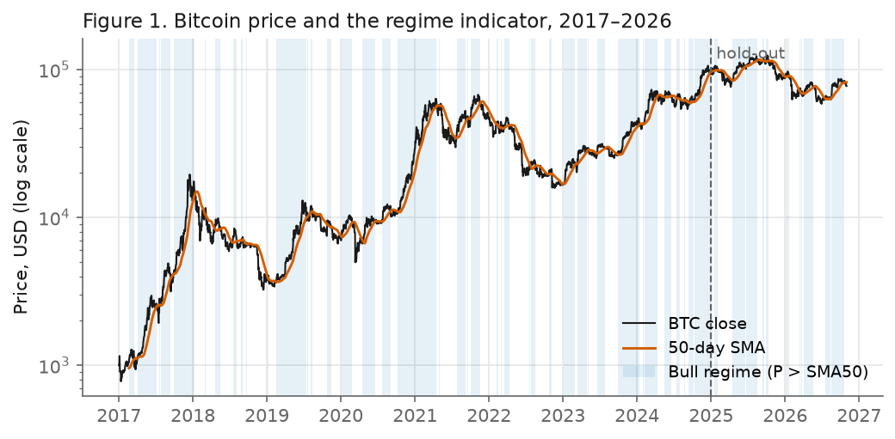
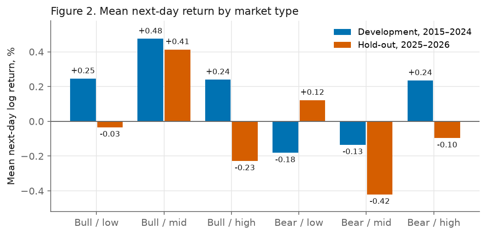
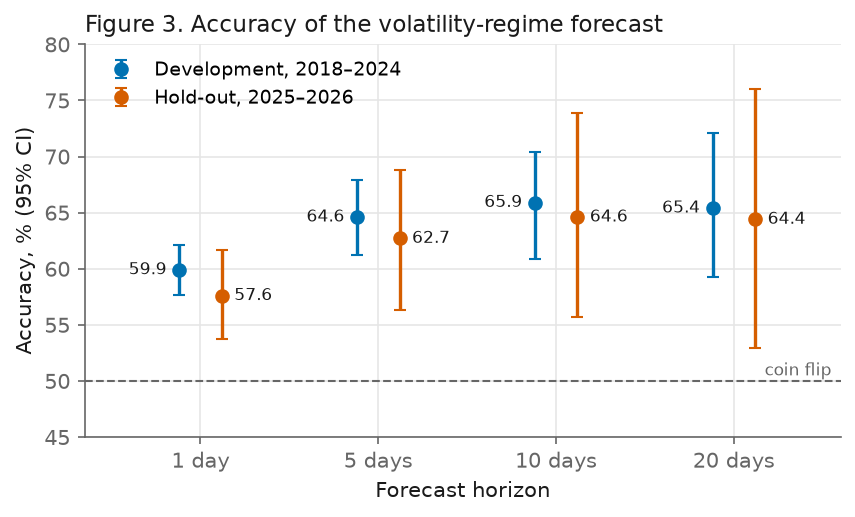
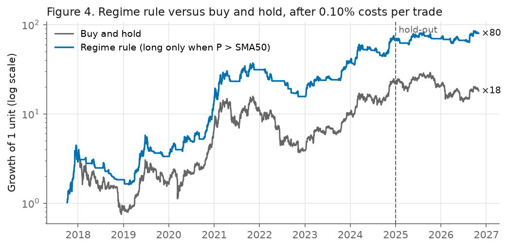

# Regime-Based Statistical Modelling of Bitcoin Price Trajectories

*Mathematical Exploration — revised edition*

---

## Summary

I set out to test whether short-term Bitcoin price movements contain mathematically detectable signals. My first version of this work reported a 60.76% prediction accuracy. When I rebuilt the analysis so that every forecast used only information available at the time, that number did not survive: the true figure was 57.14%, it was not statistically significant, and simply guessing "up" every time did better.

The regime idea at the core of the work did survive. Using Bayes' theorem I built a formula that sorts each day into one of six market types and estimates what tomorrow looks like for that type. One type, a rising trend with medium volatility, shows a positive drift that is statistically significant (t = 3.48 over 645 days) and that reappeared on 22 months of data the model had never seen (t = 2.72 over 95 days). I also found that the *size* of tomorrow's move is far more predictable than its direction: a one-line rule forecasts high or low volatility with 60–66% accuracy, and it held at 58–65% on the unseen data.

The honest conclusion is narrower than my original one, and I think it is more interesting: Bitcoin's direction is close to a coin flip, but its regime is not.

---

# 1. Introduction

## 1.1 Rationale

I have been interested in cryptocurrency for a while. I have traded small amounts on a few platforms and so far my gains have been larger than my losses, but I know it is high risk. When I asked friends how they choose a cryptocurrency, most of them described a feeling rather than a calculation.

Bitcoin is often called chaotic, and it is hard to argue with that when you watch it move. Still, I kept wondering whether the market is truly random or whether some part of it can be measured.

In boxing I know whether the person in front of me is orthodox or southpaw before they throw a punch, and that changes how I read everything they do next. This exploration applies the same idea to a market. First identify the stance (the *regime*), then ask what the mathematics says about the next move given that stance.

## 1.2 Aim

To determine whether a regime-based statistical model can predict short-term Bitcoin price movements better than chance, and to measure exactly how much better.

The investigation has three parts:

1. Model price changes with logarithmic returns, a kinematics analogy and a stochastic differential equation.
2. Derive a prediction formula from Bayes' theorem that gives the probability of a price rise for each market type.
3. Test the formula on data it has never seen, and compare it against the simplest possible alternatives.

## 1.3 What changed in this edition

The first edition optimised its parameters on the same data it used to measure accuracy, and I wrote at the time that the result "should be interpreted as an upper bound". This edition does the test I said was needed. It also corrects one methodological error I had not noticed (Section 4.1). Where a result from the first edition failed, I report the failure and explain it, because finding out *why* a pattern is false taught me more mathematics than the pattern itself.

---

# 2. Mathematical Framework

## 2.1 Logarithmic returns

A 50% loss needs a 100% gain to recover, so simple percentage changes do not add up over time. Let $r$ be the continuously compounded return over one day:

$$P_t = P_{t-1}\,e^{r} \quad\Longrightarrow\quad r_t = \ln\!\left(\frac{P_t}{P_{t-1}}\right) = \ln P_t - \ln P_{t-1}$$

Log returns add: the return over a week is the sum of seven daily log returns. This is what later allows the use of sums and averages.

**Link to the simple return.** Writing the simple return as $x = (P_t - P_{t-1})/P_{t-1}$, we have $r_t = \ln(1+x)$. The Taylor series of $f(x)=\ln(1+x)$ about $x=0$ is

$$\ln(1+x) = x - \frac{x^2}{2} + \frac{x^3}{3} - \cdots, \qquad |x|<1$$

For a typical day, $x \approx 0.01$, the second term is $0.00005$, two hundred times smaller than the first, so $r_t \approx x$.

**Error bound.** Truncating after the linear term, the Lagrange form of the remainder is

$$R_1(x) = \frac{f''(c)}{2!}\,x^2 = -\frac{x^2}{2(1+c)^2}, \qquad c \text{ between } 0 \text{ and } x$$

so the error is of order $x^2$. (My first edition called this error $O(x^3)$; that is the size of the *next* term, not of the remainder after a first-order truncation.)

> **Reflection.** The approximation depends on daily moves being small, and the data let me check that. Of the 2,921 daily returns from 2017 to 2024, 78 (2.7%) exceed 10% in absolute value. The most extreme is 12 March 2020: a simple return of −37.2% but a log return of −46.5%, a gap of more than nine percentage points. So the linear approximation fails on exactly the days that matter most. For this reason every calculation below uses exact log returns, and the Taylor series serves only to explain why log and simple returns usually agree.

## 2.2 Kinematics analogy: velocity and acceleration

If $\ln P(t)$ is treated as position, the daily log return is a finite-difference estimate of velocity, and the change in the return is an estimate of acceleration:

$$v_t = \ln P_t - \ln P_{t-1}, \qquad a_t = v_t - v_{t-1} = \ln P_t - 2\ln P_{t-1} + \ln P_{t-2}$$

Working in logarithms rather than dollars matters. A \$2,000 move meant 7% in January 2021 and 2% in 2024, so dollar velocities cannot be compared across years. Log velocities can.

To smooth out daily noise I define the trend using the 50-day simple moving average:

$$\text{trend}_t = \ln P_t - \ln\!\left(\frac{1}{50}\sum_{i=0}^{49} P_{t-i}\right)$$

**Sample calculation.** For 1–3 January 2021 (closing prices \$29,374, \$32,127, \$32,782):

$$v_2 = \ln\frac{32127}{29374} = 0.0896, \qquad v_3 = \ln\frac{32782}{32127} = 0.0202$$

$$a_3 = 0.0202 - 0.0896 = -0.0694$$

The price was still rising ($v>0$) while the rise was slowing sharply ($a<0$): a concave stretch of the curve.

> **Reflection.** In the first edition I claimed that this signature "predicted the consolidation well in advance". One example cannot show that. When I later gave acceleration to several prediction models as an input (Section 9), it added nothing measurable. I keep the analogy because it explains what trend and momentum *mean*, but I no longer claim that the second derivative is a leading indicator.

## 2.3 Geometric Brownian Motion

A price path is too jagged to differentiate in the ordinary sense, so I model it with the stochastic differential equation of Geometric Brownian Motion:

$$dP_t = \mu P_t\,dt + \sigma P_t\,dW_t$$

The drift term $\mu P_t\,dt$ is the systematic part, the signal I am looking for. The diffusion term $\sigma P_t\,dW_t$ is the noise, driven by a Wiener process $W_t$ whose increments are independent and normally distributed, $W_{t+\Delta t}-W_t \sim N(0,\Delta t)$.

Ordinary calculus does not apply to functions of $W_t$ because $(dW_t)^2$ behaves like $dt$ rather than vanishing. Itô's lemma is the chain rule that accounts for this. For $f(P_t)$:

$$df = \frac{\partial f}{\partial P}\,dP + \frac{1}{2}\frac{\partial^2 f}{\partial P^2}\,(dP)^2$$

Applying it to $f = \ln P_t$, with $f' = 1/P$, $f'' = -1/P^2$ and $(dP)^2 = \sigma^2P^2\,dt$:

$$d(\ln P_t) = \left(\mu - \frac{\sigma^2}{2}\right)dt + \sigma\,dW_t$$

Integrating over one day gives the distribution of the log return:

$$r_t \sim N\!\left(\mu - \frac{\sigma^2}{2},\ \sigma^2\right)$$

**The signal-to-noise problem.** Over $h$ days the expected return grows like $h$ while the standard deviation grows like $\sqrt{h}$, so

$$P(\text{rise over } h \text{ days}) = \Phi\!\left(\sqrt{h}\cdot\frac{\mu-\sigma^2/2}{\sigma}\right)$$

With a daily drift of about 0.2% and daily volatility of about 3.5%, the one-day ratio is roughly 0.05, which gives $\Phi(0.05) \approx 52\%$. This single line of algebra already says that one-day direction should be barely better than a coin flip, and the data in Section 6 agree.

**How well does the model fit?** GBM assumes constant $\mu$ and $\sigma$ and normally distributed returns. Bitcoin's daily returns have a sample skewness of −0.67 and an excess kurtosis of 11.3, where a normal distribution has 0 for both. The worst day in the sample lies 12.4 standard deviations below the mean, an event that a normal distribution would essentially never produce. GBM is therefore a starting point, and the regime model below is my way of relaxing its assumption that $\mu$ and $\sigma$ never change.

---

# 3. Data

| | Period | Days | Use |
| :-- | :-- | :-- | :-- |
| Development set | 17 Sep 2014 – 31 Dec 2024 | 3,759 | Building and testing every idea |
| Hold-out set | 1 Jan 2025 – 31 Oct 2026 | 669 | Opened once, at the very end |

The source is the daily closing price of BTC-USD from Yahoo Finance. As a cross-check I repeated the main results on BTCUSDT from the Binance exchange; the two closing prices differ by a median of 0.11%.

**The rule against looking ahead.** Every quantity used to make a forecast for day $t+1$ is computed from prices up to and including the close of day $t$. Averages, volatility estimates, thresholds and probabilities are all rolling or cumulative, never calculated from the whole sample.

**The hold-out.** I did not look at any 2025–2026 data until all methods and parameters were fixed. The criteria for success were written down before the test was run. A result that only works on data you have already studied is a description of the past, and the hold-out is what separates description from prediction.

---

# 4. Market Regimes

## 4.1 Definition, and a trap I fell into

A day is labelled **Bull** if its closing price is above the 50-day moving average and **Bear** otherwise.

In the first edition I then calculated the mean return of the days labelled Bull and the days labelled Bear, and found a large difference. The problem is that the label for day $t$ depends on the price of day $t$, and so does the return of day $t$. A day that jumps 8% is likely to end above its average *because* it jumped. I was partly measuring a definition, not a prediction.

The fix is to pair each label with the **next** day's return, which the label could not have known:

| Regime on day $t$ | Mean return of day $t$ (first edition) | Mean return of day $t+1$ (corrected) |
| :-- | :-- | :-- |
| Bull | +0.711% | +0.335% |
| Bear | −0.533% | −0.065% |
| Difference | 1.244% | 0.400% |

*Yahoo BTC-USD, 2017–2024, 1,591 Bull days and 1,282 Bear days.*

Two thirds of the apparent effect was an artefact. One third is real.

## 4.2 Is the remaining difference significant?

A two-sample test would normally assume independent observations, but daily returns cluster: volatile days follow volatile days. I therefore used the Newey–West estimator, which widens the standard error to account for correlation between nearby days. The difference of 0.400% per day has

$$t = 2.77, \qquad p = 0.006$$

so the hypothesis that the two regimes have the same next-day mean is rejected at the 1% level.

The volatilities also differ, 3.58% per day in Bull against 3.96% in Bear. This matches my own experience that losses in falling markets feel faster than gains in rising ones.

## 4.3 Regimes as a Markov chain

Counting how often each regime follows each regime gives the transition matrix

$$T = \begin{pmatrix} 0.957 & 0.043 \\ 0.053 & 0.947 \end{pmatrix}$$

where the first row and column are Bull. A regime with daily probability $p$ of continuing lasts on average $1/(1-p)$ days: about 23 days for Bull and 19 for Bear. The stationary distribution $\pi$ solves $\pi T = \pi$:

$$\pi_{\text{bull}} = \frac{1-0.947}{(1-0.957)+(1-0.947)} = \frac{0.053}{0.096} = 0.55$$

which agrees with the observed share of Bull days, $1591/2873 = 0.554$.

---

# 5. The Prediction Formula

## 5.1 What the first edition's formula actually answered

My original "Master Formula" used Bayes' theorem to compute $P(\text{Bull}\mid r_t)$, the probability that the market is in a Bull regime given today's return. But the regime is already known: it is read directly from the moving average. The formula answered a question nobody needed to ask.

The useful question is: **given the market type I can observe today, what is the distribution of tomorrow's return?** Bayes' theorem answers that too.

## 5.2 Six market types

Trend alone gives two regimes. Section 4.2 showed that volatility also differs between regimes, so I add it as a second dimension. Each day I compute the 30-day volatility and its rank among the previous 365 days: the lowest third is *low*, the middle third *mid*, the highest third *high*. Two trend states times three volatility states gives six market types.

## 5.3 Derivation

For one market type $s$, let $\mu_s$ be the unknown true mean of the next-day return. Before seeing any data for that type, my best guess is the overall mean $\mu_0$ of all days so far. I express this as a normal prior worth $n_0$ imaginary observations:

$$\mu_s \sim N\!\left(\mu_0,\ \frac{\sigma_s^2}{n_0}\right)$$

After observing $n_s$ days of type $s$ with sample mean $\bar x_s$, the likelihood of that sample mean is

$$\bar x_s \mid \mu_s \sim N\!\left(\mu_s,\ \frac{\sigma_s^2}{n_s}\right)$$

Bayes' theorem states that the posterior is proportional to likelihood times prior. Multiplying two normal densities and completing the square in $\mu_s$ gives another normal density, with

$$\boxed{\ \hat\mu_s = \frac{n_s\,\bar x_s + n_0\,\mu_0}{n_s+n_0}, \qquad \text{sd}(\mu_s) = \frac{\sigma_s}{\sqrt{n_s+n_0}}\ }$$

The posterior mean is a weighted average of what the data say and what I believed beforehand, with weights equal to the number of real and imaginary observations. The probability that the drift in this market type is genuinely positive is then

$$P(\mu_s>0 \mid \text{data}) = \Phi\!\left(\frac{\hat\mu_s\sqrt{n_s+n_0}}{\sigma_s}\right)$$

The same reasoning applied to the *frequency* of rising days, with a Beta prior and a Binomial likelihood, gives

$$\hat p_s^{\,\text{up}} = \frac{k_s + n_0\,p_0}{n_s+n_0}$$

where $k_s$ is the number of rising days among the $n_s$ and $p_0$ is the overall frequency of rising days.

I fixed $n_0 = 250$, roughly one year of days, before running any test. The prior matters most when a market type has few observations, where it pulls an extreme early estimate back toward the overall average. This protects the formula from the over-confidence that sank the first edition.

Because the counts $n_s$, $k_s$ and $\bar x_s$ are updated one day at a time, every forecast the formula makes uses only the past.

## 5.4 Worked example

At the end of 2024, for the type **Bull / mid volatility**:

| Quantity | Value |
| :-- | :-- |
| Days observed, $n_s$ | 645 |
| Rising days, $k_s$ | 363 |
| Sample mean, $\bar x_s$ | 0.4752% |
| Sample standard deviation, $\sigma_s$ | 3.277% |
| Overall mean, $\mu_0$ | 0.1709% |
| Overall frequency of rising days, $p_0$ | 0.5318 |

**Step 1: posterior mean.**

$$\hat\mu_s = \frac{645(0.004752) + 250(0.001709)}{645+250} = \frac{3.0650 + 0.4273}{895} = 0.003902$$

**Step 2: posterior standard deviation.**

$$\text{sd} = \frac{0.03277}{\sqrt{895}} = 0.001095$$

**Step 3: probability that the drift is positive.**

$$z = \frac{0.003902}{0.001095} = 3.56, \qquad P(\mu_s>0) = \Phi(3.56) = 0.9998$$

**Step 4: probability of a rise tomorrow.**

$$\hat p^{\,\text{up}} = \frac{363 + 250(0.5318)}{895} = \frac{495.95}{895} = 0.554$$

So in this market type the model is almost certain that the average move is upward, yet it gives only a 55.4% chance that any particular tomorrow is a rising day. Those two statements are both true, and the gap between them is the central finding of this exploration: the edge is in the *average size* of moves, not in how often they go the right way.

## 5.5 The formula's state at the end of 2024

| Market type | $\hat p^{\,\text{up}}$ | $\hat\mu_s$ per day | $P(\mu_s>0)$ |
| :-- | :-- | :-- | :-- |
| Bull / mid | 55.5% | +0.39% | 0.9998 |
| Bull / low | 53.8% | +0.23% | 0.996 |
| Bull / high | 54.0% | +0.22% | 0.949 |
| Bear / high | 52.6% | +0.21% | 0.891 |
| Bear / mid | 51.3% | −0.02% | 0.442 |
| Bear / low | 50.9% | −0.08% | 0.212 |

---

# 6. Testing the Formula

## 6.1 Development period

| Market type | Days | Rising days | Mean next-day return | $t$ (Newey–West) |
| :-- | :-- | :-- | :-- | :-- |
| Bull / low | 716 | 53.9% | +0.25% | 2.15 |
| **Bull / mid** | **645** | **56.3%** | **+0.48%** | **3.48** |
| Bull / high | 721 | 54.4% | +0.24% | 1.57 |
| Bear / low | 607 | 50.1% | −0.18% | −1.59 |
| Bear / mid | 384 | 50.3% | −0.13% | −0.64 |
| Bear / high | 477 | 52.4% | +0.24% | 1.22 |

*April 2015 – December 2024. Overall frequency of rising days: 53.2%.*

One market type stands out. With six types tested, the Bonferroni-corrected threshold for 5% significance is $0.05/6 = 0.0083$, which corresponds to $|t| > 2.64$. Bull / mid passes; no other type does.

## 6.2 The hold-out test

The result above was found on data I had studied. The real question is whether it appears on data I had not.

| Market type | Days | Rising days | Mean next-day return | $t$ (Newey–West) |
| :-- | :-- | :-- | :-- | :-- |
| Bull / low | 203 | 48.3% | −0.03% | −0.28 |
| **Bull / mid** | **95** | **55.8%** | **+0.41%** | **2.72** |
| Bull / high | 44 | 45.5% | −0.23% | −0.91 |
| Bear / low | 100 | 50.0% | +0.12% | 0.50 |
| Bear / mid | 101 | 47.5% | −0.42% | −1.89 |
| Bear / high | 125 | 46.4% | −0.10% | −0.52 |

*January 2025 – October 2026. Bitcoin fell 17% over this period; overall frequency of rising days: 49.0%.*

The Bull / mid type reproduced almost exactly: 55.8% rising days against 56.3%, and a mean of +0.41% per day against +0.48%. No other type came close to significance, which is also what the development period predicted.

**Testing the frequency.** Of the 95 hold-out days of this type, 53 rose. Under the null hypothesis $p = 0.5$, $X \sim B(95, 0.5)$ and

$$P(X \ge 53) = 0.152$$

The frequency alone is **not** significant. Ninety-five days is too few to distinguish 55.8% from 50%.

**Testing the mean.** The sample mean is 0.414% with standard deviation 2.124%, so

$$t = \frac{0.00414}{0.02124/\sqrt{95}} = 1.90$$

which is significant at the 5% level in a one-sided test, and the Newey–West version gives 2.72.

> **Reflection.** I find it striking that the two tests disagree. Counting only *whether* each day rose throws away the information about *how much*, and here that information is where the pattern lives. It also means I must be careful in how I describe the result. "The model predicts the direction 56% of the time" is not established. "In this market type the average daily move is positive" is.

## 6.3 What happened to 60.76%?

The first edition's headline came from a different signal: when the price was more than 2.4 standard deviations from its 20-day mean, predict that the move would continue for five days. Rebuilding that calculation from the description in my own text gave:

| Check | Result |
| :-- | :-- |
| Accuracy at the reported settings | 76 correct of 133 = **57.14%**, not 60.76% |
| Exact binomial test against 50% | $p = 0.059$, not significant |
| "Always predict up" on the same 133 events | 66.9% |
| Same settings on 2022–2024 only | 51.0% (51 events) |
| Same settings on the 2025–2026 hold-out | 44.0% (25 events); "always up" scored 60.0% |

The figure 60.76% does not correspond to any whole number of successes out of 133, so it was a transcription error. More importantly, the signal lost to the simplest possible strategy, because it predicted *falls* after sharp drops and Bitcoin more often bounced.

Three separate mistakes produced the original claim, and each has a name in statistics:

1. **The wrong null hypothesis.** I tested against 50%, but over five days Bitcoin rose 54.6% of the time. The fair comparison is against "always up".
2. **Multiple testing.** I tried four window lengths and several thresholds, then reported the best. Among 264 combinations of window, threshold and horizon that I later tested, the best is expected to look impressive by luck alone.
3. **Dependent observations.** The 133 events fall on consecutive days and their five-day windows overlap. There are only about 77 independent events, so the binomial test overstated the evidence.

I also checked whether the signal contains anything once the regime is known. It does not: extreme values above the mean occur almost only in Bull regimes and those below almost only in Bear regimes. After subtracting the regime's usual return, nothing is left ($|t| < 1.3$ in every case, pooled over more than 600 events).

---

# 7. What *Is* Predictable: the Size of the Move

Section 4.2 found that regimes differ in volatility, and Section 2.3 found that returns have far fatter tails than a normal distribution. Both point to the same fact: volatility is not constant, and it clusters.

That suggests a different forecast. Instead of asking whether tomorrow is up or down, ask whether the coming days will be *turbulent or calm*.

**The rule.** Let $\hat\sigma_t$ be an exponentially weighted estimate of daily volatility with a 10-day half-life. Forecast "above-median volatility over the next $h$ days" if and only if $\hat\sigma_t$ is above its own median for the previous year. The rule has no parameters fitted to the outcome.

| Horizon | Development accuracy (95% CI) | Hold-out accuracy (95% CI) |
| :-- | :-- | :-- |
| 1 day | 59.9% (57.7 – 62.1) | 57.6% (53.7 – 61.7) |
| 5 days | 64.6% (61.2 – 67.9) | 62.7% (56.3 – 68.8) |
| 10 days | 65.9% (60.9 – 70.4) | 64.6% (55.7 – 73.9) |
| 20 days | 65.4% (59.3 – 72.1) | 64.4% (52.9 – 76.0) |

*Development: 2018–2024, about 2,550 days. Hold-out: 2025–2026, about 660 days. Confidence intervals from a block bootstrap, which resamples whole runs of consecutive days to respect their dependence.*

Every interval lies entirely above 50%, in both periods. This is the result I was looking for when I started, in a place I was not looking.

> **Reflection.** Direction and size behave completely differently. Returns themselves are nearly uncorrelated from day to day, which is why direction is so hard. Their *magnitudes* are strongly correlated, a property known as volatility clustering. Mathematically, $r_t$ can be unpredictable while $|r_t|$ is predictable, and the GBM model of Section 2.3, with its constant $\sigma$, cannot represent this at all. For a trader, a volatility forecast does not say which way to bet, but it does say how large a position is safe.

---

# 8. Does the Regime Help in Practice?

To see whether the regime has practical value I compared two rules: hold Bitcoin all the time, or hold it only on days following a Bull label. Each switch is charged a cost of 0.10%, a typical exchange fee.

| | Regime rule | Buy and hold |
| :-- | :-- | :-- |
| **Development, 2017–2024** | | |
| Sharpe ratio | 1.54 | 1.16 |
| Largest fall from a peak | −57% | −83% |
| **Hold-out, 2025–2026** | | |
| Total return | +19.8% | −17.1% |
| Sharpe ratio | 0.51 | −0.02 |
| Largest fall from a peak | −25.5% | −53.0% |

*The Sharpe ratio is the mean return divided by its standard deviation, annualised; it measures return per unit of risk.*

The regime rule came out ahead in both periods, and in the hold-out it made money while the asset lost. I have to qualify this in two ways.

First, the improvement is in **risk**, not in average return. During the development period the mean daily return of the two rules was statistically indistinguishable ($t = -0.12$). The rule earns about the same while being out of the market 45% of the time, and so avoids the deepest falls.

Second, the difference in Sharpe ratios is **not statistically significant**. A bootstrap 95% confidence interval for the difference is $(-0.10,\ 0.94)$ in development and $(-0.60,\ 1.54)$ in the hold-out. Both contain zero. Eight years is simply not long enough to prove that one Sharpe ratio exceeds another when the returns are this volatile.

The rule is robust in other ways: it stayed profitable for every moving-average length from 10 to 200 days, and its advantage would survive trading costs twelve times higher than those assumed.

---

# 9. Approaches That Did Not Work

I tested several more sophisticated methods on the same data, each with forecasts made only from the past. I include them because their failure is evidence for the main conclusion.

| Method | Result |
| :-- | :-- |
| Momentum after extreme price deviations (first edition) | Worse than "always up"; see Section 6.3 |
| Bayesian formula over 5–30 day horizons | Less accurate than a constant; its most confident forecasts were right 18–25% of the time |
| Two-state hidden Markov model fitted to returns | Separated calm from turbulent periods, not rising from falling |
| Gradient-boosted trees, 28 inputs, 32 configurations | Mean AUC 0.497, where 0.5 is random |
| Neural networks, 2 and 3 hidden layers | 52% in development; 48% on the hold-out |

The failure of the longer horizons is instructive. The formula $\Phi(\sqrt{h}\,\mu/\sigma)$ from Section 2.3 predicts that accuracy should improve with the horizon. It did the opposite, because that formula assumes $\mu$ stays fixed for $h$ days, while Section 4.3 showed that a regime lasts only about 20. The forecast window was longer than the thing being forecast.

When a simple formula, decision trees and neural networks all arrive at the same ceiling, the limit is in the data and not in the method. Price and volume history contain enough information to identify the regime, and very little beyond that.

---

# 10. Conclusion

I asked whether a market described as chaotic contains mathematically detectable signals. The answer is yes, with precise limits.

| Finding | Evidence |
| :-- | :-- |
| Market regimes are real | Next-day mean return differs between Bull and Bear by 0.40% per day ($t = 2.77$, $p = 0.006$) |
| One market type has a significant drift | Bull / mid volatility: $t = 3.48$ in development, $t = 2.72$ on unseen data |
| Direction is nearly unpredictable | At best 56% rising days, and not significant as a frequency on the hold-out ($p = 0.152$) |
| Volatility is predictable | 60–66% accuracy in development, 58–65% on unseen data, all intervals above 50% |
| The regime reduces risk | Largest fall of −57% against −83%; on unseen data +19.8% against −17.1% |
| The original 60.76% was an artefact | True value 57.14%; lost to "always up" in every period tested |

The "islands of predictability" I wrote about in the first edition exist, but they are smaller and in a different place than I thought. The market's *direction* tomorrow is close to a coin flip in five of six market types. Its *state*, meaning whether it is trending and whether it is turbulent, is persistent and measurable.

## Limitations

- **One asset, one decade.** Everything rests on a single price series. The hold-out period covers 22 months and a falling market; a different period could behave differently.
- **Few independent observations.** The Bull / mid result on the hold-out rests on 95 days, which occur in clusters. The confidence in it should be moderate.
- **Choices I made.** The 50-day window, the 30-day volatility, the three-way split and $n_0 = 250$ were fixed before testing, but they were still my choices. I checked that nearby values give similar results for the regime rule; I did not check every combination for the six-type formula.
- **The model is descriptive.** It does not explain *why* a rising trend with moderate volatility should carry a positive drift. A plausible reason is that investors react slowly to good news, but this exploration does not test that.

## Further work

Two extensions follow directly. Volatility forecasts could be used to size positions, holding less when turbulence is expected. And the regime may predict quantities other than price: in a side investigation, a three-day average predicted whether the funding rate on Bitcoin futures would be above its yearly median with 84% accuracy in 2020–2024 and 79% in 2025–2026.

## Personal reflection

I began this work wanting mathematics to replace gut feeling in my trading, and I was pleased when the first version gave me 60.76%. Rebuilding it taught me that the feeling of having found a pattern is itself a kind of gut feeling, and that mathematics is as useful for testing my own conclusions as for testing the market.

The most valuable thing I take from the exploration is a habit: before believing a result, ask what the simplest alternative would have scored, and then test on data I have not seen. For my trading, the practical lesson is modest. I should not expect to know where the price goes tomorrow. I can know what kind of market I am in, and how hard it is likely to hit.

---

# Bibliography

1. Bailey, David H., and Marcos López de Prado. "The Deflated Sharpe Ratio: Correcting for Selection Bias, Backtest Overfitting, and Non-Normality." *The Journal of Portfolio Management*, vol. 40, no. 5, 2014, pp. 94–107.
2. Baxter, Martin, and Andrew Rennie. *Financial Calculus: An Introduction to Derivative Pricing*. Cambridge University Press, 1996.
3. Binance. "Public Market Data." *data.binance.vision*, 2017–2026. Accessed 23 Nov. 2026.
4. Cont, Rama. "Empirical Properties of Asset Returns: Stylized Facts and Statistical Issues." *Quantitative Finance*, vol. 1, no. 2, 2001, pp. 223–36.
5. Gelman, Andrew, et al. *Bayesian Data Analysis*. 3rd ed., CRC Press, 2013.
6. Haese, Michael, et al. *Mathematics: Analysis and Approaches HL*. Haese Mathematics, 2019.
7. Hamilton, James D. "A New Approach to the Economic Analysis of Nonstationary Time Series and the Business Cycle." *Econometrica*, vol. 57, no. 2, 1989, pp. 357–84.
8. Harris, Charles R., et al. "Array Programming with NumPy." *Nature*, vol. 585, 2020, pp. 357–62.
9. Künsch, Hans R. "The Jackknife and the Bootstrap for General Stationary Observations." *The Annals of Statistics*, vol. 17, no. 3, 1989, pp. 1217–41.
10. Liu, Yukun, and Aleh Tsyvinski. "Risks and Returns of Cryptocurrency." *The Review of Financial Studies*, vol. 34, no. 6, 2021, pp. 2689–727.
11. Mandelbrot, Benoit B. "The Variation of Certain Speculative Prices." *The Journal of Business*, vol. 36, no. 4, 1963, pp. 394–419.
12. Newey, Whitney K., and Kenneth D. West. "A Simple, Positive Semi-Definite, Heteroskedasticity and Autocorrelation Consistent Covariance Matrix." *Econometrica*, vol. 55, no. 3, 1987, pp. 703–08.
13. The Pandas Development Team. "pandas-dev/pandas: Pandas." *Zenodo*, 2024, doi:10.5281/zenodo.3509134.
14. Yahoo Finance. "Bitcoin USD (BTC-USD) Historical Data." *finance.yahoo.com/quote/BTC-USD/history*. Accessed 23 Nov. 2026.

---

# Appendix: Reproducibility

Every number in this document was produced by code and can be regenerated. The data files, their checksums, and one script per result are kept together with the full history of changes. Results that failed are stored alongside those that succeeded.

| Result | Script |
| :-- | :-- |
| Reconstruction of the first edition (Section 6.3) | `src/baseline.py`, `src/audit.py` |
| Market types and the Bayesian formula (Sections 5–6) | `src/exp10_map.py`, `src/exp10_bayes.py` |
| Volatility forecast (Section 7) | `src/exp12_vol_predict.py` |
| Regime rule (Section 8) | `src/audit.py`, `src/holdout.py` |
| Methods that failed (Section 9) | `src/meta.py`, `src/exp11_horizon.py`, `src/exp14_nn_long.py` |
| Hold-out test (all sections) | `src/holdout.py` |
| Figures and worked-example values | `src/paper_figures.py` |
